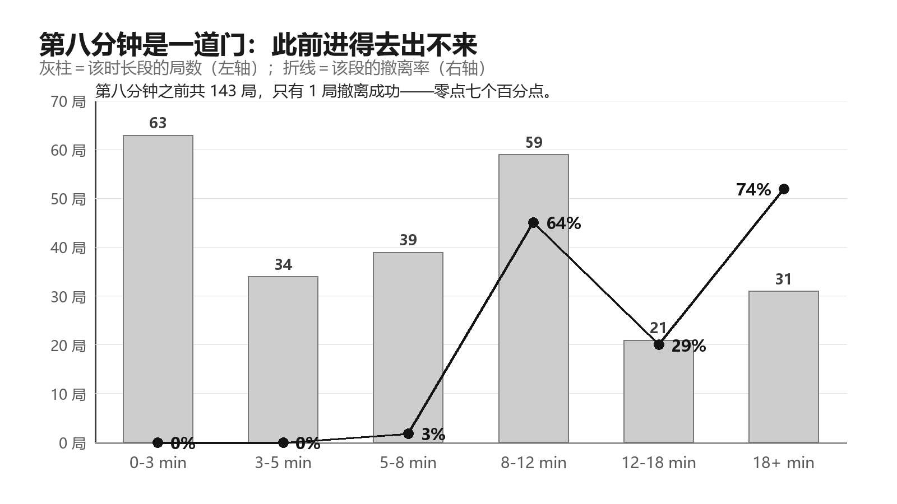
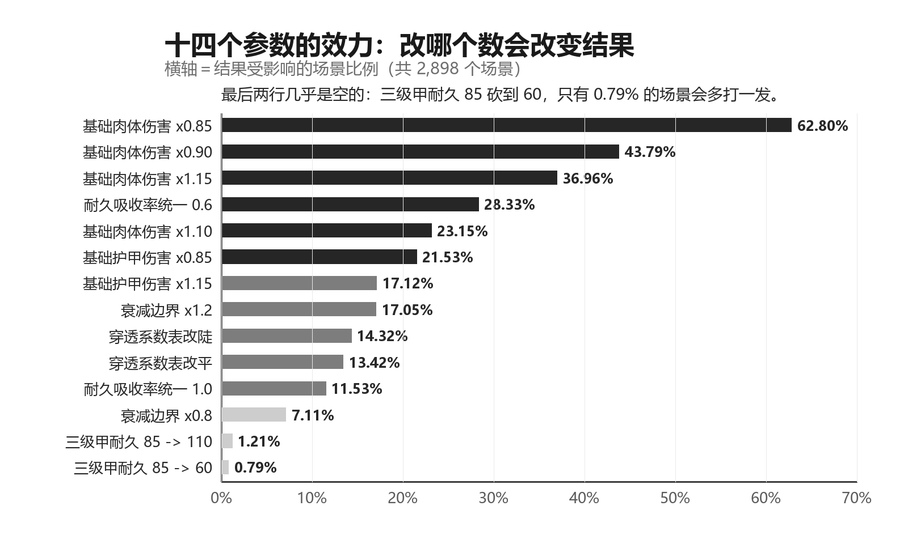
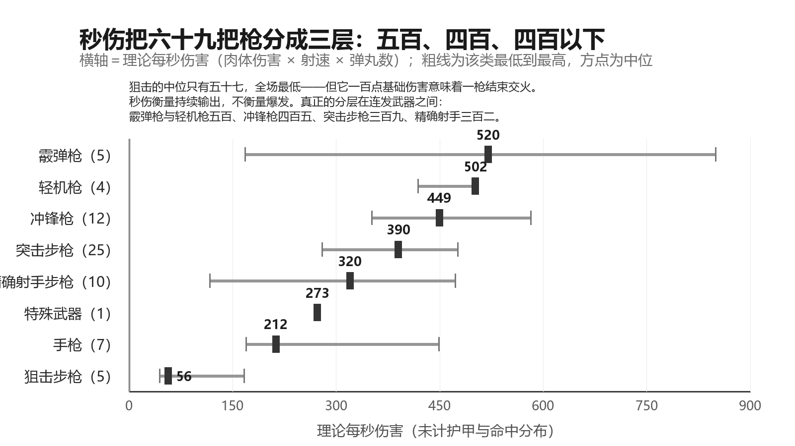
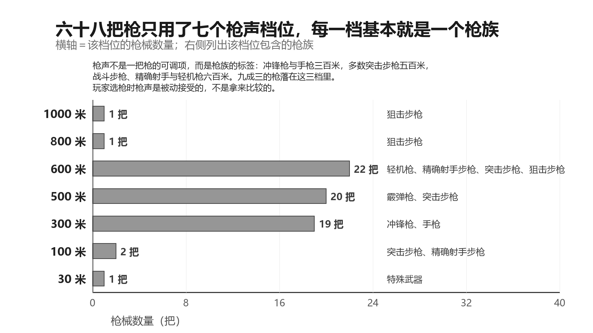
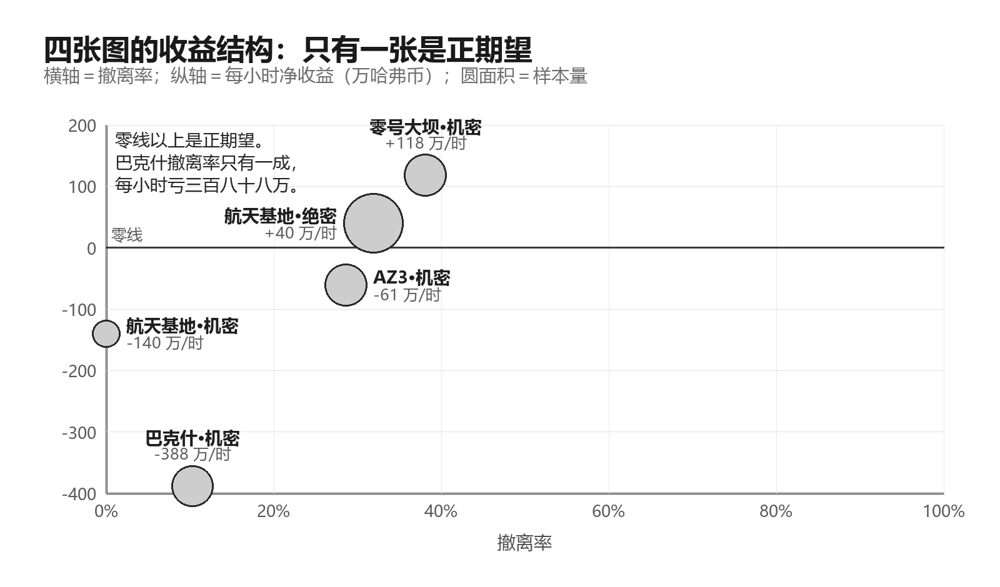
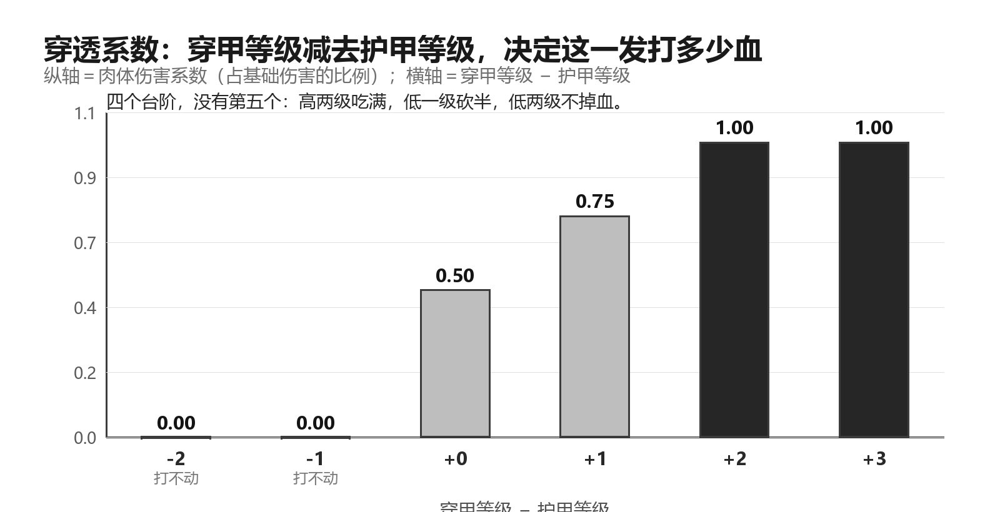

# 三角洲行动：一款搜打撤射击的系统与数值拆解

> 不做通关心得，只把黑盒拆成公式。
> 6 张图的 47 个撤离点、69 把枪的伤害矩阵、247 局逐局结算、1,774 张配置表与 59 个脚本文件的完整解析——
> 全部可以复算，错的也全部写在 [ERRATA.md](ERRATA.md) 里。

**一句话结论：这款游戏的节奏不由数值决定，由出口的开放条件决定。**

---

## 三个最硬的发现

### 一、撤离点的数量与撤离率无关，出生点密度才是局时的参数

六张图合计 **47 个撤离点**，但从 **10 个到 3 个**，撤离率并不随之上升：

| 地图 | 撤离点 | 撤离率 | 出生点密度（每 km²） | 局时中位 |
|---|---:|---:|---:|---:|
| AZ3 | **16** | 28.6% | 21.4 | 6.5 min |
| 航天基地 | **3** | **31.5%** | 18.7 | **8.8 min** |
| 巴克什 | 6 | **10.3%** | **30.6** | **3.2 min** |

按出生点密度从密到疏排列，局时中位依次是 **3.2 / 6.5 / 6.7 / 8.8 分钟**——严格单调。
想拉长一局，加减撤离点没用，改出生点密度。

### 二、八分钟那道坎，不是"走不到"

出生点到最近撤离点的直线距离中位只有 **94–348 米**，按冲刺速度一分钟能到。
但前八分钟的撤离率是 **0.7%**（143 局里只有 1 局成功），第九分钟跳到 **75%**。

原因不在路上：47 个撤离点里，**只有 21% 是走到即走**，其余要求你先合闸、凑道具、付费、接任务。
**它把撤离从一个空间问题改成了流程问题。**



### 三、耐久池是假旋钮

把三级甲的耐久从 85 砍到 60（约三分之一），击杀所需发数发生变化的场景只有 **0.79%**。
继续砍到 1/17，封顶 **2.48%**——饱和了。

同一套模型里，把"耐久吸收率"从 1.0 统一到 0.6，变化 **28.33%**。**差 14 倍。**



---

## 为什么这些数字可信

不是靠"我觉得"，是靠四类互相独立的数据源交叉：

| 数据源 | 拿到什么 | 怎么验证 |
|---|---|---|
| 官方地图工具的点位表 | 6 张图的尺寸、83 个出生点、47 个撤离点、1,600+ 个物资点坐标 | 点位数量与地图内图例对账 |
| 第三方数据站（DFTTK） | 69 把枪、119 种弹药、25 件护甲、557 个配件的全部字段 | 与自算的 833 格穿透矩阵逐格比对，**零例外** |
| 游戏内训练场实测 | 部位倍率、距离衰减、破甲转移 | 12 个读数逐点命中，误差 0 |
| 玩家账号的逐局结算 | 247 局的时间、带入带出、击杀、藏品 | 与生涯面板的 2,427 局总量交叉 |

**三重校验**：833 格穿透矩阵无例外 → 345 个距离边界点全对 → 与官方计算器 396 点比对 69.4% 完全一致、秩相关 0.79–0.91。

---

## 六张图

| 图 | 说的事 |
|---|---|
|  | 秒伤把 69 把枪分成三层，狙击是例外：中位只有 56，但一枪结束交火 |
|  | 68 把枪的枪声只用了 7 个离散档位，每档基本就是一个枪族（图按有枪声数据的 66 把绘制） |
|  | 第八分钟是一道门，之前进得去出不来 |
|  | 四张图只有一张是正期望，而玩家多数时间在打那张负期望的 |
|  | 十四个参数的真实效力，最后两行几乎是空的 |
|  | 穿透系数只有四个台阶，没有第五个 |

---

## 我在这个项目里错了 20 次

这是我认为比结论更有价值的部分。完整清单见 [ERRATA.md](ERRATA.md)，几条代表性的：

| 我原先写的 | 实际是 | 为什么会错 |
|---|---|---|
| 声音是第一属性，玩家按枪声选枪 | 玩家按秒伤选枪；枪声只有 7 档且与枪族绑定，**根本没得选** | 把"设计者的旋钮"当成了"玩家的决策变量" |
| 8 分钟 × 5.9 m/s = 2,832 米 | 出生点到撤离点中位只有 94–348 米 | 算出来的距离比任何地图的对角线都长，当时没做量纲核对 |
| 每张图有常规、机密、绝密三档 | 只有一张图三档齐，两张只有两档，一张没有常规 | 拿一张图的规律套了全部 |
| 最贵收藏品 5,277 万，与最便宜差 3.17 万倍 | 5,277 万是**配置基准值**，实拍最高成交 260 万 | 把配置值当成了成交价 |
| 赛季重置剥离装备 | 这款游戏**不删档**，资产永久继承 | 把同类产品的机制想当然了 |

自检能漏掉六条硬错的教训，直接写进了方法：**证伪优先于拟合**——如果一个模型能推出"穿更低的甲反而更慢打死"，那一定是模型错了，不是设计错了。

---

## 仓库结构

```text
.
├── README.md                 # 你正在看
├── ERRATA.md                 # 20 条自我纠错
├── METHOD.md                 # 数据来源、验证路径、以及"哪一步可能错"
├── data/                     # 聚合数据（不含任何游戏原始资源）
│   ├── map-geometry.json         # 6 张图的尺寸/点位/距离
│   ├── exfil-types.json          # 47 个撤离点的十种类型
│   ├── player-sample.json        # 247 局的聚合统计
│   ├── parameter-sensitivity.json # 14 个参数变体的效力
│   └── weapons.csv               # 69 把枪的伤害/射速/秒伤/枪声
├── figures/                  # 6 张分析图
└── scripts/
    ├── make_figures.py           # 只读 data/，重画全部 6 张图
    ├── chartlib.py               # 零依赖的 PIL 绘图库（这台机器装不上 matplotlib）
    ├── export_data.py            # 从本地分析产物导出聚合 JSON
    └── export_weapons.py         # 导出 69 把枪的对比表
```

## 复现

`data/` 是自足的：克隆下来就能把 6 张图重画一遍。

```bash
pip install pillow
python scripts/make_figures.py
```

从零重算全部数字需要本地有游戏客户端与公开数据站的数据（`export_data.py` / `export_weapons.py`
读的是本地分析产物），这部分不在仓库里，也无法一键复现——这是这份拆解最实的一个限制。

---

## 边界

- **不含任何游戏原始资源**。仓库里没有配置表原文、没有脚本字节码、没有资源包内容；只有聚合统计、推导结果、图表和我自己写的代码。
- **不含竞品的一手数据**。塔科夫、暗区突围、ARC Raiders 的数值来自公开 Wiki 与社区讨论，属二手引用，结论按二手处理。
- **交互手感层是推断**。新手前十分钟的引导流程来自界面文案与模块名，没有录屏实测。
- **商业化的金额不可得**。能看到的是皮肤表结构与抽奖的玩法包装，看不到流水、付费率、ARPU。
- **数据会过时**。游戏在更新，地图点位与数值都会变；这里的一切对应某个确定的时间切片。

---

## 关于

一名求职者做的作品集项目。如果它对你有用，欢迎直接拿走里面的方法；如果发现算错了，非常欢迎提 issue——这个项目最不缺的就是承认错误的经验。
